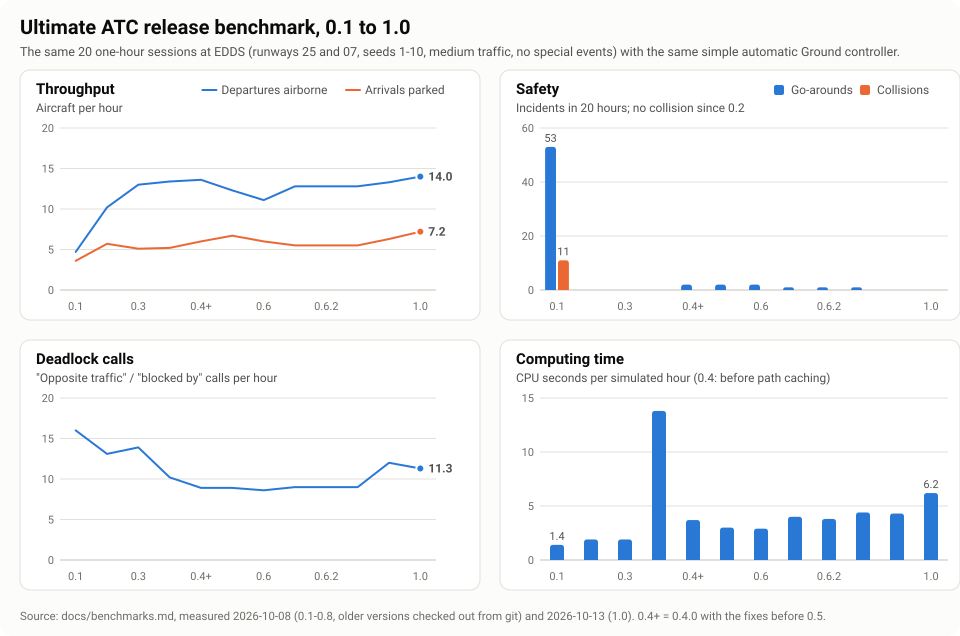

# Benchmarks and release statistics

Every **major release** (1.0, 2.0, ...) gets a statistics section here that shows how much faster, safer and better the simulator has become since the previous major release. Minor releases are measured too, so the trend is visible.

- [How it is measured](#how-it-is-measured)
- [Results by version](#results-by-version)
- [Simulated traffic](#simulated-traffic)
- [Major release statistics](#major-release-statistics)

---

## How it is measured

`npm run benchmark` runs the **release benchmark** (`tests/benchmark.test.ts`): 20 sessions of one hour (runways 25 and 07, seeds 1-10, medium traffic, no special events) with the same simple automatic controller in every version:

- approves pushbacks when nothing taxis within 250 m, sends departures to the runway with the shortest route (`taxi to runway 25`), sends arrivals to their suggested stand, hands departures to Tower when they ask,
- never sequences, never re-routes, never resolves a deadlock.

So the numbers measure the **simulation**, not good controlling: a human controller does much better. They are comparable between versions because the controller and the sessions are always the same. `npm run soak` runs a harder variant with special events and more heavies.

| Measure | Meaning |
| ------- | ------- |
| Departures / h | Departures airborne per hour (average of 20 sessions) |
| Arrivals / h | Arrivals parked per hour |
| Collisions, incursions, go-arounds | Total over all 20 hours |
| Deadlock calls / h | Pilot calls "opposite traffic" / "blocked by" per hour (the automatic controller never answers them, so a deadlock keeps calling) |
| Computing time | CPU time per simulated hour (Node.js 22, one core of a 2.1 GHz Xeon). The browser at 8x needs 8 simulated hours per real hour |

## Results by version

Measured on 2026-10-08 with the same benchmark for every version (older versions checked out from git):

| Version | Departures / h | Arrivals / h | Collisions | Incursions | Go-arounds | Deadlock calls / h | Computing time / sim. hour |
| ------- | -------------: | -----------: | ---------: | ---------: | ---------: | -----------------: | -------------------------: |
| 0.1.0   | 4.7  | 3.6 | 11 | 0 | 53 | 16.0 | 1.4 s |
| 0.2.0   | 10.2 | 5.7 | 0  | 0 | 0  | 13.1 | 1.9 s |
| 0.3.0   | 13.0 | 5.1 | 0  | 0 | 0  | 13.9 | 1.9 s |
| 0.4.0   | 13.4 | 5.2 | 0  | 0 | 0  | 10.2 | 13.8 s |
| 0.4.0 + fixes (before 0.5) | 13.6 | 6.0 | 0 | 0 | 2 | 8.9 | 3.7 s |
| 0.5.0   | 12.3 | 6.7 | 0  | 0 | 2  | 8.9  | 3.0 s |
| 0.6.0   | 11.1 | 6.0 | 0  | 0 | 2  | 8.6  | 2.9 s |
| 0.6.1   | 12.8 | 5.5 | 0  | 0 | 1  | 9.0  | 4.0 s |
| 0.6.2   | 12.8 | 5.5 | 0  | 0 | 1  | 9.0  | 3.8 s |
| 0.7.0   | 12.8 | 5.5 | 0  | 0 | 1  | 9.0  | 4.4 s |
| 0.8.0   | 13.3 | 6.3 | 0  | 0 | 0  | 12.0 | 4.3 s |
| **1.0.0** (2026-10-13) | 14.0 | 7.2 | 0 | 0 | 0 | 11.3 | 6.2 s |
| 1.1.0 (2026-10-14) | 14.0 | 7.2 | 0 | 0 | 0 | 11.3 | 3.0 s |

**Since 0.1** (0.5.0 compared with 0.1.0): 2.6 times as many departures, 1.9 times as many arrivals per hour, no more collisions (11 → 0) and go-arounds (53 → 2) in 20 hours, 44 % fewer deadlock calls. In 0.5.0 the real Stuttgart traffic mix replaced the generic one (more Eurowings and Turkish traffic, fewer small regional jets), which shifts the departure and arrival numbers slightly; the benchmark sessions are otherwise identical. v0.4.0 introduced the crossing-priority rule, which made the simulation about 7 times slower; caching the sampled paths brought it back to 3.7 s per simulated hour (less than 1 % of a CPU core at 1x).

Soak test (0.5.0, 20 h with special events and more heavies in every third session): 11.8 departures and 6.9 arrivals per hour, no collisions, no incursions, 2 go-arounds, 3.9 s computing time per simulated hour. It now runs in CI on every push.

**0.6.0**: A-CDM and CTOTs make the departure flow more realistic, not faster: crews call for pushback 2 minutes before their TSAT instead of at their ready time, 12 % of the departures have a CTOT and wait for it (on the stand via the TSAT, at the holding point if early), and the sequencer spaces start-ups by 90 s. That costs about 1 departure per hour in the benchmark (the automatic controller is still Ground only; Delivery is AI). Soak test 0.6.0: 12.2 departures and 7.2 arrivals per hour, no collisions, no incursions, 2 go-arounds, 3.1 s computing time per simulated hour.

**0.6.1**: the A-CDM fix (TSATs no longer slide later) brings departures up from 11.1 to 12.8 per hour. Arrivals are slightly lower because tows now keep remote stands occupied for 20-40 minutes and slow tows share the apron; the calmer session start also means fewer departures in the first minutes. The automatic controller approves tows like pushbacks (nothing taxiing within 250 m) - tows are new in 0.6.1. Computing time is higher because of the vehicles and the extra checks. Soak test 0.6.1: 11.2 departures and 6.7 arrivals per hour, no collisions, no incursions, 1 go-around, 5.4 s computing time per simulated hour.

**0.6.2** (vehicle radio, radio discipline): same traffic results as 0.6.1. Soak test 0.6.2: 11.3 departures and 6.8 arrivals per hour, no collisions, no incursions, 1 go-around.

**0.8.0** (pilots resolve simple conflicts): an aircraft already in the other one's lane now always goes first, so two aircraft no longer stop nose to nose on a connector like H (stand-offs at intersections dropped from 6 to 0 in the 20 hours). Departures rise from 12.8 to 13.3 and arrivals from 5.5 to 6.3 per hour. Deadlock calls rise from 9.0 to 12.0 per hour because crews who see opposite traffic in time now stop short of the junction between them and call (`opposite traffic on taxiway N ... request instructions`) - the automatic controller never answers, but a controller (or the AI Ground) can now turn one of them off at that junction instead of ordering a tug. Soak test 0.8.0: 12.1 departures and 6.8 arrivals per hour, no collisions, no incursions, 1 go-around, 6.3 s computing time per simulated hour.

**1.0.0** (scenario conditions, tutorials, review fixes): landing aircraft now keep their exit speed until they are behind the holding point instead of creeping at 10 kt inside the runway area. That frees the runway sooner: departures rise from 13.7 to 14.0 and arrivals from 6.8 to 7.2 per hour compared with the state before the review (13.3 / 6.3 in 0.8.0). Computing time is higher (6.2 s per simulated hour) because of the night, weather and closure checks and the extended conflict checks. Soak test (1.0.0): 12.9 departures and 7.0 arrivals per hour, no collisions, no incursions, **2 go-arounds** (before the review fixes: 5) - both caused by the same random rejected take-off (the aircraft blocked the runway, and later its second departure attempt). Without special events no go-around was left in any of the diagnostic runs.

**1.1.0** (P1/P2, de-icing pads, de-icing scenario option): the benchmark sessions do not use de-icing, and the new taxiways and pads do not change a single route - the results are identical to 1.0.0. Soak test (1.1.0): 12.9 departures and 7.0 arrivals per hour, no collisions, no incursions, 2 go-arounds (the same rejected take-off as in 1.0.0). With de-icing (not part of the benchmark; AI Ground and the scripted Tower controller, 5 sessions of 2 h per runway, second hour): 9.4 departures per hour on runway 25 (10.4 without de-icing) and 8.4 on runway 07 (13.6 without) - every departure spends 6-10 minutes on a pad, and on runway 07 the de-iced departures share taxiway N with the arrivals.

The second part of 1.1.0 (Nuremberg, Memmingen, Sylt, runway backtracking; released as 1.2.0 at first and folded into 1.1.0) leaves the benchmark at Stuttgart, where nothing is backtracked and the stand reserve is off - the Ground results are identical (the computing time of 3.0 s instead of 5.8 s comes from a less busy machine, not from the code). The AI Ground now keeps a departure on its stand while its way out would meet opposite traffic; at Stuttgart that changes one route in 20 hours (Tower benchmark: 10.6 instead of 10.5 arrivals per hour). Soak test (1.1.0 with the airports): 12.9 departures and 7.0 arrivals per hour, no collisions, no incursions, 2 go-arounds (the same rejected take-off as in 1.0.0). The new airports are covered by their own tests: one hour per runway direction with a scripted controller, no collisions (Nuremberg as Ground, Memmingen with backtracks, Sylt as the only Tower position).

### Tower benchmark (since 0.7)

The same 20 sessions with you as **Tower** (Ground and Delivery run by the simulator) and a simple scripted Tower controller: it clears arrivals to land inside 4 NM when nobody is lined up, clears a departure for take-off when the runway is free, the next arrival is more than 110 s away, the departure spacing is met and its CTOT window is open, hands departures to Radar and arrivals to Ground when they ask, and clears crossings when the runway is free and the next arrival is more than 90 s away.

| Version | Departures / h | Arrivals to Ground / h | Collisions | Incursions | Go-arounds | Separation losses | Missed hand-offs |
| ------- | -------------: | ---------------------: | ---------: | ---------: | ---------: | ----------------: | ---------------: |
| 0.7.0 | 11.4 | 10.1 | 0 | 0 | 0 | 0 | 0 |
| 0.7.x (early hand-off to Tower) | 10.3 | 10.8 | 0 | 0 | 0 | 0 | 0 |
| 0.8.0 | 11.2 | 10.3 | 0 | 0 | 0 | 0 | 0 |
| **1.0.0** (2026-10-13) | 11.2 | 10.5 | 0 | 0 | 0 | 0 | 0 |
| 1.1.0 (2026-10-14) | 11.2 | 10.6 | 0 | 0 | 0 | 0 | 0 |

Since the AI Ground hands departures over before the holding point, the scripted controller (which only clears aircraft that have reached the holding point) sees queues on its own frequency that the AI Ground no longer manages; departures dropped by about 1 per hour, arrivals rose slightly. In 0.8.0 the lane priority on the ground brings departures back to 11.2 per hour.

The first run of this benchmark found two problems that were fixed for the release: conflict resolution could send a departure on a detour across the runway (now never chosen by the AI Ground and shown last in the menu), and the AI Ground could not get out of a circle of aircraft blocking each other around a pushback.

## Simulated traffic

How many hours of traffic have been simulated while developing and testing the simulator. Since this page exists, every test file reports its simulated hours (`[simulated traffic] ... h` in the test output; a full `npm test` run currently simulates about **35 h**, plus 20 h for the soak test in CI).

| Period | Simulated traffic | Note |
| ------ | ----------------: | ---- |
| v0.1 - v0.4 (development, before counting) | ~100 h | estimate: test suite runs and debugging harnesses |
| after v0.4 (tablet mode, scenarios, briefing, stand fixes) | ~130 h | estimate: test suite runs, debugging, soak tests |
| version benchmark, 2026-10-08 | 120 h | measured: 5 versions x 20 h, plus a repeat of the current version |
| soak tests, 2026-10-08 | 60 h | measured: 3 runs x 20 h |
| 0.5.0 development | ~70 h | estimate: test suite runs (8.5 h each) and debugging |
| 0.5.0 release benchmark and soak test | 40 h | measured: 2 x 20 h |
| 0.6.0 development (systems, conflicts, Delivery) | ~60 h | estimate: test suite runs (about 9 h each) and debugging |
| 0.6.0 release benchmark and soak test | 40 h | measured: 2 x 20 h |
| 0.6.0 - 0.6.1 benchmark and soak runs (bisecting, tuning) | 240 h | measured: 7 benchmark and 5 soak runs of 20 h |
| 0.6.0 - 0.6.1 development | ~135 h | estimate: test suite runs (about 10 h each) and debugging harnesses |
| 0.6.2 - 0.7.0 benchmark, Tower benchmark and soak runs | 160 h | measured: 3 benchmark runs (Ground and Tower) and 2 soak runs of 20 h |
| 0.6.2 - 0.7.0 development | ~60 h | estimate: test suite runs and debugging harnesses |
| after 0.7.0 (Tower benchmark runs while tuning the early hand-off) | 72 h | measured: 3 Tower benchmark runs of 20 h, 3 diagnostic runs of 4 h |
| 0.8.0 development and release (combined positions, opposite traffic, debriefing) | 288 h | measured: 4 benchmark runs and 4 soak runs of 20 h, 3 deadlock analysis runs of 20 h, combined-position test runs (28 h) |
| 0.8.0 development | ~100 h | estimate: test suite runs (about 11 h each) and debugging harnesses |
| Total up to 0.8.0 | ~1680 h | of which 1020 h exactly measured |
| 0.9 / 1.0: benchmark runs (Ground + Tower) | 400 h | measured: 10 runs of 2 x 20 h (after each change, plus comparisons) |
| 0.9 / 1.0: soak tests | 60 h | measured: 3 runs of 20 h |
| 0.9 / 1.0: diagnostic runs (all positions, scenarios, go-around analysis, traces) | ~140 h | estimate from the run lengths |
| 0.9 / 1.0: test-suite runs | ~450 h | estimate: about 30 runs, growing from 9 to 24 h each (one run now simulates 24 h) |
| **Total up to 1.0.0** | **~2730 h** | of which 1480 h exactly measured |
| 1.1: benchmark and soak runs | 160 h | measured: 3 benchmark runs (Ground + Tower) and 2 soak runs |
| 1.1: de-icing diagnostic runs | 160 h | measured: one 1-h and five 2-h comparisons (AI Ground, with and without de-icing) |
| 1.1: test-suite runs and traces | ~130 h | estimate |
| 1.1 (airports): benchmark and soak runs | 160 h | measured: 3 benchmark runs (Ground + Tower) and 1 soak run |
| 1.1 (airports): airport diagnostic runs (EDDN, EDJA, EDXW: 1-h sessions per runway and seed while tuning) | ~150 h | estimate from the run lengths |
| 1.1 (airports): test-suite runs | ~600 h | estimate: about 20 runs of up to 35 h each |
| **Total up to 1.1.0** | **~4090 h** | of which 1960 h exactly measured |

From now on each benchmark, soak test and test-suite run adds its measured hours here when results are recorded.

## Major release statistics

### 1.0.0 (released 2026-10-13)

Measured on 2026-10-13 (see also the [release report](release-1.0-report.md)). 1.0 is compared with **0.4.0**, the first version with a complete Ground position and the baseline of the release benchmark, and with 0.1.0.

| Measure (release benchmark, 20 x 1 h) | 0.1.0 | 0.4.0 | 1.0.0 | Change since 0.4 |
| ------------------------------------- | ----: | ----: | ------------: | ---------------- |
| Departures airborne / h               | 4.7   | 13.4  | 14.0          | +4 %             |
| Arrivals parked / h                   | 3.6   | 5.2   | 7.2           | +38 %            |
| Collisions (20 h)                     | 11    | 0     | 0             | -                |
| Incursions (20 h)                     | 0     | 0     | 0             | -                |
| Go-arounds (20 h)                     | 53    | 0     | 0             | -                |
| Deadlock calls / h                    | 16.0  | 10.2  | 11.3          | +11 % (crews call earlier since 0.8, see above) |
| Computing time / simulated hour       | 1.4 s | 13.8 s | 6.2 s        | -55 %            |

- **Since 0.1**: 3 times as many departures and twice as many arrivals per hour, no collisions (11 → 0) and no go-arounds (53 → 0) in the 20 benchmark hours.
- **Since 0.4**: Delivery and Tower became playable (alone and combined), with A-CDM, CTOTs, DCL, systems, coordination, night rules, closures, thunderstorms, tutorials and a debriefing - and the simulation still got faster than 0.4 (13.8 → 6.2 s per simulated hour).
- **Tower position** (since 0.7): 11.4 → 11.2 departures and 10.1 → 10.5 arrivals handed to Ground per hour with the scripted Tower controller, never a collision, incursion, go-around, separation loss or missed hand-off.
- **Soak test** (special events, more heavies): 0.5.0 11.8 / 6.9 per hour, 2 go-arounds → 1.0.0 12.9 / 7.0 per hour, 2 go-arounds (both from one rejected take-off), never a collision.
- **Simulated traffic** up to 1.0.0: about **2730 hours** (1480 h exactly measured), see [Simulated traffic](#simulated-traffic).
